<div align="center">





</div>

```console
sarthak@sarthak ~ $ systemctl --user list-units --state=running
● robot-perception.service     camera frames -> vision model -> action
● fleet-orchestration.service  VLM planning, code-verified dispatch, rule fallback
● realtime-control.service     MQTT / WebSockets / BLE command loops @ 220ms
● local-inference.service      quantized LLMs + VLMs on llama.cpp, vLLM, whisper.cpp
● edge-vision.service          ARM boards, Yocto, OpenCV, YOLO
● full-stack.service           dashboards, APIs, React Native apps
● cloud-infra.service          AWS, GCP, Docker, CI/CD
```

<p align="center">
  
</p>

```console
sarthak@sarthak ~ $ spidey-sense --status
```

```diff
+ robots ................... moving
+ vision model ............. confident (verified anyway)
+ control loop ............. 220ms
+ coffee ................... critical mass
- sleep schedule ........... 404 not found
- "5 min fix" .............. day 3
- the model ................ tried to assign a task to a robot it imagined. validator said no.
```

```console
sarthak@sarthak ~ $ git log --oneline -5
```

```text
e1f3a9c (HEAD -> main) fix: robot no longer accepts tasks at 3% battery out of pure optimism
7b2d04e feat: latency now lower than my reply time on Slack
c9a1f77 chore: renamed final_v2_REAL_final.py to something I won't regret
3e8b521 fix: it was DNS. it's always DNS.
0000001 init: got bitten by a radioactive bug, started writing code
```

```console
sarthak@sarthak ~ $ crontab -l
```

```bash
0  9  * * 1-5   coffee && ship
*/5 * * * *     check_robot_is_still_where_i_left_it
0  3  * * *     prod_incident   # never scheduled, always on time
@reboot         blame_the_network
```

```console
sarthak@sarthak ~ $ cat principles.txt
```

> With great `sudo` comes great responsibility.
>
> Continuous, steady improvement beats a delayed "perfect" release.

<div align="center">

<a href="https://sarthaksportfolio.netlify.app/"></a>
<a href="https://linkedin.com/in/sarthak-mishra-ba32501bb"></a>
<a href="https://pypi.org/project/robofleet/"></a>
<a href="https://leetcode.com/sarthak_mishra_"></a>

</div>

```console
sarthak@sarthak ~ $ exit
logout: thwip.
```


